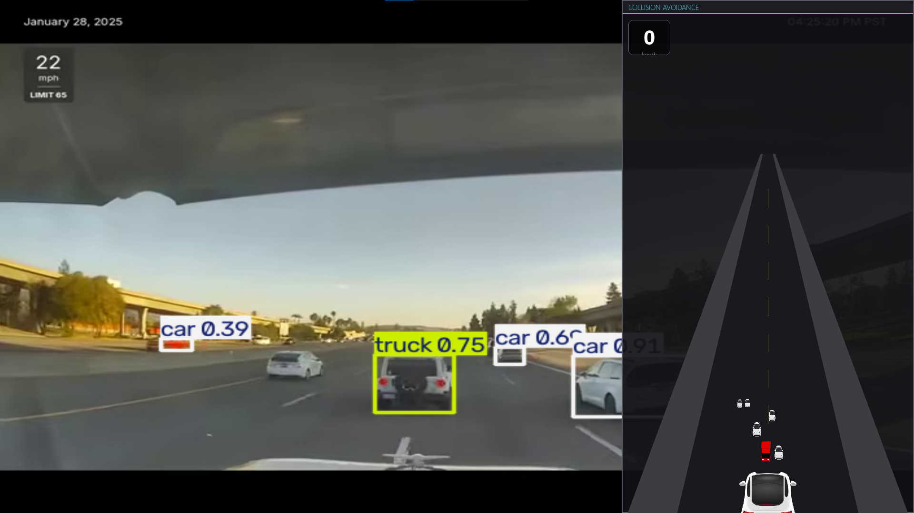
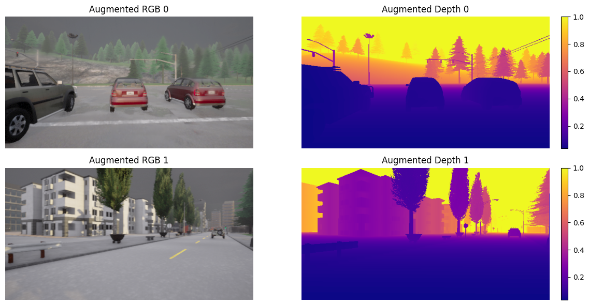
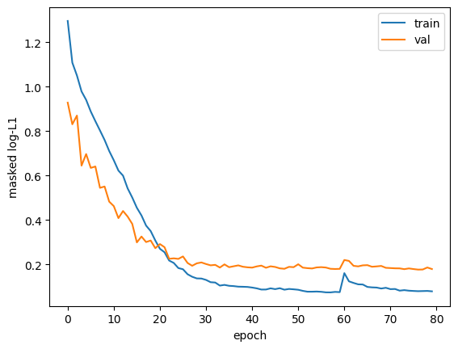

# driveR


driveR is a monocular driver-assistance prototype. It detects and tracks road users from one camera, estimates their position, calculates collision risk, and displays warnings on a bird's-eye-view HUD.

The live application currently estimates distance with a calibrated ground-plane homography. A separately trained monocular depth model is available for experiments, but it is not yet connected to the risk engine.



## Contents

- [How it works](#how-it-works)
- [Current status](#current-status)
- [Getting started](#getting-started)
- [Camera calibration](#camera-calibration)
- [Depth experiments](#depth-experiments)
- [Project layout](#project-layout)
- [Known limitations](#known-limitations)
## How it works

```text
Camera or video
      │
      ▼
YOLO object detection
      │
      ▼
DeepSORT tracking
      │
      ▼
Bounding box → ground-plane position
      │
      ▼
Kalman filtering + C++ risk calculation
      │
      ▼
Bird's-eye-view HUD
```

The detector looks for people, cars, motorcycles, buses, trucks, traffic lights, and stop signs. The tracker gives each confirmed object a persistent ID. For each tracked box, the system projects its bottom-center point onto the ground plane to estimate lateral position and distance ahead.

The risk manager uses distance and estimated closing speed to calculate time to collision (TTC). The HUD displays tracked objects and highlights caution or warning states.

| Risk level | Current trigger |
| --- | --- |
| Caution | Object closer than 8 m, or TTC at most 4 s |
| Warning | Object closer than 4 m, or TTC at most 2 s |

These are prototype thresholds. They have not been validated as safe driving limits.

## Current status

| Component | Status |
| --- | --- |
| YOLO detection and DeepSORT tracking | Connected to the live pipeline |
| Ground-plane distance estimation | Connected; requires camera calibration for meaningful distances |
| C++ TTC and risk evaluation | Connected |
| Bird's-eye-view HUD | Connected |
| Monocular depth model | Trained separately; not connected to live risk evaluation |
| CARLA and Raspberry Pi sources | Source adapters exist; deployment and validation remain in progress |

The application can read a local video or webcam. It also has source adapters for CARLA and a Pi camera.

## Getting started

The setup below uses Windows PowerShell and Python 3.11, the environment used during development.

### Requirements

- Python 3.11
- A C++17 compiler available to Python's build tools
- **Eigen C++ headers** at `risk_engine_src/Eigen/Eigen/Dense`
- A compatible `yolo26s.pt` detector checkpoint in the project root
- A webcam, or a video at `Datasets/brake_check.mp4`

The Python package named `eigen` does not provide the C++ headers required by the risk engine. Model weights, datasets, compiled extensions, and local videos are ignored by Git, so a fresh clone needs those files supplied separately.

### Install and build

Run these commands from the project root:

```powershell
python -m venv venv
.\venv\Scripts\Activate.ps1
python -m pip install -r requirements.txt
python setup.py build_ext --inplace
```

The build should place `risk_engine_cpp` in the project root, where `main.py` can import it.

### Run

```powershell
python main.py --source webcam
```

To use the default video source, place a clip at `Datasets/brake_check.mp4` and run:

```powershell
python main.py
```

Use `q` to close the application.

### Display options

```powershell
python main.py --hud-mode standalone
python main.py --hud-mode panel
python main.py --hud-mode panel --panel-side left
```

`standalone` opens the detection feed and HUD in separate windows. `panel` places the HUD beside the detection feed in one window.

The CARLA source requires a running CARLA server and its Python package. The Pi camera source requires `picamera2` on supported hardware.

## Camera calibration

Distance estimates from a homography depend on the camera position, angle, and image size. Without `homography.npy`, the application uses a placeholder transform. Its distances and HUD positions are rough guesses.

To calibrate a camera, capture a frame from its installed position and run:

```powershell
python calibration_tool.py path\to\calibration_frame.jpg
```

Click at least four ground-plane points whose real lateral and forward positions you have measured. The tool writes `homography.npy` in the current directory. Run it from the project root so `main.py` can load the result.

Recalibrate if the camera mounting or image geometry changes.

## Depth experiments

The experimental depth model uses a MobileNetV3 encoder and a decoder that predicts a dense **log-depth map** from one RGB image. Training uses paired RGB images and depth arrays from CARLA. The training code is in `sim/depth/`.

A local training run reported approximately **2.7 m validation MAE**. This is a general depth result; it does not yet measure object-distance accuracy inside 10 m or the effect on collision warnings.





The training script expects data in this layout:

```text
data/
└── Town_Weather_Seed/
    ├── rgb/
    │   └── 000000.png
    └── depth/
        └── 000000.npy
```

Matching filenames form an RGB/depth pair. The depth arrays contain metres. The training script splits data by episode, masks ground-truth depths at 50 m and beyond, and saves its best checkpoint as `best_depth_aug.pt`.

From the project root:

```powershell
python -m sim.depth.train
```

The `data/` directory and trained `.pt` files are not included in Git.

The planned comparison is focused on the collision-prevention task: object-distance errors inside **10 m**, missed warnings, false warnings, warning lead time, and processing latency. The depth model will be compared with YOLO depth models using the same frames, detections, tracks, and risk logic before any live integration.

## Project layout

```text
driveR/
├── main.py                 # Live pipeline and command-line options
├── calibration_tool.py     # Interactive camera calibration
├── setup.py                # Build configuration for the C++ extension
├── requirements.txt
├── perception/
│   ├── Detector.py         # YOLO detection
│   ├── tracker.py          # Persistent object tracks
│   ├── BEVTransform.py     # Image-to-ground-plane projection
│   └── risk_manager.py     # Distance, TTC, and risk levels
├── risk_engine_src/
│   ├── risk_engine.cpp     # TTC thresholds and risk result
│   └── kalman_filter.cpp   # Position and velocity filtering
├── sim/
│   ├── frame_sources.py    # Video, webcam, Pi camera, and CARLA sources
│   └── depth/
│       ├── dataset.py      # Paired RGB/depth loading
│       ├── model.py        # Depth network
│       └── train.py        # Training loop
├── visualization/
│   ├── HUD.py              # Live display
│   └── icon_map.py         # Object and warning icons
├── assets/icons/
└── docs/
```

## Known limitations

- Distance and HUD placement are unreliable until the camera is calibrated.
- Risk evaluation does not yet consider whether an object is in the ego vehicle's lane or moving into it.
- TTC and distance thresholds are fixed rather than adjusted for vehicle speed.
- The HUD speed display has no live speed source and currently shows zero.
- The trained depth model does not yet provide distances to the live risk engine.
- The CARLA training data is synthetic. Real-camera performance and warning quality still need measured evaluation.

## Safety

driveR is a research prototype. It does not control the vehicle and is not a certified safety system. Do not rely on it while driving.
